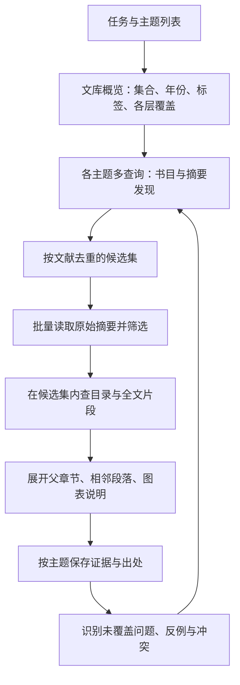

# Agent 渐进式文献检索改进方案

日期：2026-11-04。本文保留基于 0.3.5 的原始设计与目标；核心渐进检索已在 0.4.0 开发构建实施，实际参数见 [Agent 使用说明](Agent使用说明.md)，验证与未完成事项见 [0.4.0 验证说明](0.4.0验证说明.md)。下文拟议字段并非全部原样实现，不能将设计目标当作已验证能力。保持单个 Zotero 插件，不要求用户部署新的服务或安装其他运行时。

## 1. 结论与范围

下一轮应围绕“摘要优先、候选文献集内精查、按证据逐层展开”重构检索，不继续把不同层级的文本扔进一次全库相似度排序。

用户提出的文献调研流程是：一个任务含多个主题，每个主题可能要反复换关键词、限定研究对象、筛选候选、比较证据、补查空白。插件负责快速、可复现、带出处地提供资料；当前对话中的 Agent 负责拆题、提出查询、判断相关性和写作。插件内部不再额外运行一个负责拆题和总结的 LLM。

新增运行组件建议仅为 **MiniSearch**，打包进入 XPI。保留已有 SQLite、MinerU、Qwen/可选向量 API、ONNX/WASM 和 Zotero 原生书目及 CSL。MiniSearch 官方声明零外部依赖；版本、打包大小、中文策略、Gecko Worker 兼容性和内存开销仍须验证，不将浏览器支持说明直接等同于 Zotero 兼容性结论。

## 2. 当前问题与可确认边界

1. `Library.search()` 每次调用 `store.documents()`，把所有派生文献 JSON（包含全文、章节、分块和向量）读出并解析。即使只搜书目，也走这条路径。源码已确认这种不必要的数据读取；此前约 5 秒的关键词搜索究竟有多少时间花在 I/O、JSON、主线程评分和后台任务竞争，仍需分段计时。
2. `keywordScore()` 是查询词是否在字符串内出现的比例，不是倒排检索，也没有词频、逆文档频率、标题加权和完整布尔条件。
3. `layer=auto` 把多个层的块放在同一轮匹配，文献级采用最佳块。这不等于“先看摘要，再深入证据”。
4. 当前只有 library/year/publication 过滤；缺少集合、标签、年份区间、指定候选集、文献内搜索、分页、查询批次和明确的查新范围。
5. MCP status 默认带出全部 432 条任务；文本与结构化结果又重复承载大量 JSON。概览、文献查询和维护任务应该使用不同的返回粒度。
6. 实测 `I. References` 被归为正文，导致一条参考文献排到全文混合检索第一；某条日期被直接截取成 `08/2`。这些是数据结构与规范化问题，单纯换 embedding 不能解决。
7. 当前派生库中的 432 条候选记录不等于完整 Zotero 文献库，191 条当前已入库记录也不等于 191 篇都有全文。发现、摘要覆盖、全文覆盖和向量就绪必须分别报告。

## 3. 已核对的成熟方案

| 方案与来源 | 本轮核实的能力 | 本项目采用方式 |
| --- | --- | --- |
| [PaperQA2](https://github.com/Future-House/paper-qa) | 科学文献的迭代查询、证据收集、带引用回答；复用已建索引。Apache-2.0，Python 包 | 借鉴“找文献—收集证据—补查—回答”的过程；不安装 Python 服务，不引入其额外 LLM 和外部元数据供应商依赖 |
| [LlamaIndex Recursive Retrieval](https://docs.llamaindex.ai/en/stable/examples/retrievers/recursive_retriever_nodes/) | 利用节点引用与层级关系定位、展开内容；框架 MIT | 借鉴文献—章节—段落父子关系；摘要优先是本项目在文献调研场景下的适配，不声称官方强制这个流程 |
| [Haystack AutoMergingRetriever](https://docs.haystack.deepset.ai/docs/automergingretriever) | 多个子块命中时，可回到父节点获得上下文；Apache-2.0 | 命中短段，按需合并至逻辑章节，避免碎片化证据；不部署 Haystack |
| [Haystack Metadata Filtering](https://docs.haystack.deepset.ai/docs/metadata-filtering) / [QueryExpander](https://docs.haystack.deepset.ai/docs/queryexpander) | 元数据预过滤、多种查询改写与检索编排 | 复用过滤与多查询思路；查询改写由已有 Agent 提供，不额外调用插件内 LLM |
| [MiniSearch](https://github.com/lucaong/minisearch) | JavaScript 内存倒排引擎，字段加权、过滤、增量更新、序列化，官方声明零外部依赖；[源码](https://github.com/lucaong/minisearch/blob/master/src/MiniSearch.ts) 包含 BM25+、AND/OR/AND_NOT；MIT | 首选新增词法检索组件，直接随 XPI 分发，在 Worker 执行；不让用户安装 npm 或 Node |
| [Orama](https://github.com/oramasearch/orama) | 官方列出全文、向量、混合检索、过滤和 facets；[LICENSE](https://github.com/oramasearch/orama/blob/main/LICENSE.md) 为 Apache-2.0 | 作为备选。先不与 MiniSearch 同时引入；只有小规模兼容性/性能比较显示显著收益时才更换引擎 |
| [SQLite FTS5](https://www.sqlite.org/fts5.html) | BM25、短语、列过滤、布尔与 NEAR 查询；unicode61 和 trigram 等分词器 | 可评估的磁盘倒排后端。Zotero 所带 SQLite 是否启用该模块必须探测；不下载原生扩展作为默认方案。中文短词也不能只依靠 trigram |
| [54yyyu/zotero-mcp](https://github.com/54yyyu/zotero-mcp/blob/main/docs/tools.md) / [Agent 指南](https://github.com/54yyyu/zotero-mcp/blob/main/docs/for-agents.md) | 集合、标签、相关条目等浏览入口，区分部分结果与完整扫描；服务/CLI 为 MIT，plugin 子目录为 AGPL-3.0-or-later | 借鉴范围发现和 Agent 工作约定；不安装其 Python/Chroma 路线，不搬入其插件 |
| [ZotSeek MCP](https://github.com/introfini/ZotSeek/blob/main/docs/MCP.md) | 文献/片段检索、来源与页码、分数含义和检索边界说明 | 继续只借鉴；不从 ZotSeek 修改，不共享其数据库。融合排名与余弦分数都不能作为跨主题的“科学相关性概率” |

上述项目说明这些方法已有可参考实现，并不证明任何一个可直接替换为本插件并满足全部要求。本轮没有在 Zotero 内安装或运行这些框架。

## 4. 默认工作流：摘要优先，证据按需展开

### 第一层：书目发现

- 提供 Zotero 书目、集合层级、标签、期刊、作者、规范化年份与 DOI。同步轻量书目不等于自动上传或向量化所有 PDF。
- 精确标题、作者、DOI、集合和年份过滤优先走结构化查询；研究问题默认搜索标题、关键词和摘要。
- 文献结果以 `libraryID + itemKey` 为稳定论文身份；一个条目多个附件不算多篇文献，返回附件可用性供后续选择。不同条目疑似重复可提示，不自动合并用户 Zotero 条目。

### 第二层：原始摘要筛选

- 发现请求默认输出紧凑候选卡片：标题、作者、年份、期刊、匹配依据、短摘录、摘要/全文可用性及稳定身份。
- Agent 从每个主题的候选集批量取原始摘要，例如每次 5–10 篇，受总字符预算限制；完整摘要可翻页。摘要来自 Zotero `abstractNote`，或有明确来源标记的 MinerU 原文 Abstract，不能把生成式概述当原文摘要。
- 筛选状态包括“相关”“待核查”“不相关”，保留 Agent 的理由及使用的证据层。摘要未提到某实验方法不等于全文没有；摘要缺失或边界不清的条目进入待核查，而不是直接排除。
- 允许按标题/对象/年份明确不相关时先排除，避免为了固定顺序而强行读每篇摘要。

### 第三层：候选集内精查

- 只在某个主题候选集、指定文献或指定附件内搜索正文，支持 methods/results/discussion 等章节角色、原始章节标题、关键词组合和精确术语。
- 角色识别保留原文标题与置信信息，识别不了返回 unknown；不能凭标题强行把研究内容归类。
- 允许直接全库全文搜索：摘要缺失、寻找具体数值/方法、补查反例时，摘要优先是默认策略而非接口限制。
- 默认排除参考文献、页眉页脚等非证据块；参考文献可以在显式引用追溯模式单独检索，不能冒充论文自己的发现。

### 第四层：扩展证据并回到主题

- 搜索先返回短片段；读取时可展开所属逻辑章节、相邻段落和相关图表说明，防止引用半句话、公式断裂或脱离限制条件。
- 逻辑章节与页内块分开建模：跨三页的“Discussion”是一个逻辑章节，下挂各页块；页码仍来自真实解析结构。
- 每条证据带论文身份、附件身份、章节路径、段落/页码范围、原始文本与索引版本。已有 MinerU 结果的页码精度不足时明确标注，不虚构更精细坐标。
- Agent 按“主题—论点—支持/反驳/限制—证据—出处”记录对照表；是否支持或反驳由 Agent 判断并标明，不以相似度分数自动决定。

## 5. 多主题、多轮检索的接口能力

尽量扩展现有少量工具，而不是增加几十个工具。旧调用保持可用，新参数采用渐进暴露。

| 入口 | 拟议变化 |
| --- | --- |
| `literature_status` | 默认紧凑概览与各层覆盖；不返回全部任务。维护任务另走分页入口；明确只代表派生库还是完整 Zotero 书目范围 |
| `literature_search` | 保留单查询，增加有上限的 `queries` 批次、主题 ID、候选集/文献范围、集合/标签/作者/年份区间、布尔组、排除项、章节角色、结果预算与稳定 cursor |
| `literature_read` | 保留单文献，增加受预算限制的批量原始摘要/目录读取；片段读取可取前后邻居与父章节 |
| `literature_workspace`（新增） | 创建/更新本次调研中的主题候选集、已筛选状态、查阅进度和保存的证据。只写插件自己的派生数据，不擅自改 Zotero 标签/集合 |
| 现有引用工具 | 消费已选论文身份并核对最新书目；不把格式化文本声称为 Word 动态域 |

首次只读检索不要求创建 workspace：Agent 也可以直接把上一轮返回的论文 ID 用于下一轮 scope。只有需要跨对话保存、多人/多 Agent 衔接时才使用持久工作区。

一个批次应逐个返回 query_id、theme_id、结果、覆盖、耗时与错误，而不是把全部查询混成一张不可追溯的排名。个别子查询失败不取消所有已完成结果。不同主题不互相吞掉同一篇文献；可以总表去重并保留多主题归属。

搜索返回 `next_cursor`、`has_more`、快照/索引版本、已检查范围与截断原因。可在同一范围内排除已看文献，查看新增候选；某篇文献换了正文版本则标记变化，不能仅因看过旧版就永久跳过。索引变化导致 cursor 失效时明确报告，不静默漏页或重复。

每个候选解释命中哪些查询词、来自标题/摘要/正文、词法或向量分支；BM25、余弦与 RRF 分别标注，不能用一个分数跨主题判断哪个科学结论更可信。真正的主题相关性由摘要与证据筛选确定。

## 6. 最小依赖的索引与执行架构

### 存储与查询解耦

- SQLite 继续为派生数据权威存储。拆开书目、摘要、逻辑章节、证据块、向量、索引版本及 workspace 记录，给范围字段建普通索引。查询不再加载整库 DocumentRecord JSON。
- MiniSearch 在专用检索 Worker 维护倒排索引，至少分为书目/摘要发现索引与正文证据索引。持久化可恢复快照；增量更新后调整对应记录，避免每次查询或重启都重新解析全部向量。
- 标题、作者、DOI 等结构化字段和摘要文本分别处理。专有术语、元素符号、同位素、数字、连字符词默认精确；模糊匹配只对合适词启用，不能把 Nd、Ni 等短符号随意纠错。
- 中文采用经测试的分词/二元切分策略，搭配原文精确短语校验。MiniSearch 有布尔组合不代表自动拥有位置短语/NEAR 索引；这部分能力须在候选集上验证，或以后评估 FTS5，不能在接口文案中提前承诺。

### 向量与融合

- 继续用当前 Qwen/用户已配置向量 API。单独保存书目、摘要、正文块的归一化向量，按需载入为 typed arrays，不把数值数组在 JSON 中反复解析。
- 查询向量按规范化查询、模型指纹、语言/指令版本缓存；候选与结果缓存还需包含 scope 和 corpus revision，不能复用过期索引。
- 词法与向量是两个并行召回分支，再融合、按文献聚合、控制同一论文片段数和结果多样性。先取词法候选再做向量判断会漏掉不同措辞的相关论文，因此不能作为语义检索的唯一入口。
- 全库发现优先扫体量较小的摘要/论文向量，精查再限定到候选集正文向量。准确扫描放 Worker；只有实测规模需要时才考虑额外 WASM ANN 库，不先安装向量数据库。
- 初版不要求额外 reranker 模型或新的 API Key。先完成倒排、范围过滤、查询组合和证据清洗，再用评测决定 reranker 是否有收益。

### 与后台入库共存

- 交互查询优先于后台文档 embedding。后台按较小批次执行，在当前批次结束后让出；不承诺可抢占正在执行的 WASM 推理。
- 对同查询合并并缓存，对多主题查询做有界批处理；限制批次数、字符预算、并发和总体耗时，避免一个 Agent 抢占全部资源。
- 保留最后一份成功索引；新版本在事务完成/Worker 成功更新后再切换 revision，不能暴露“索引只建了一半”的搜索视图。
- 状态、结果与正文严格限量。MCP 为兼容性可同时提供文本与结构化表示，但文本不再重复大批内部任务详情；若客户端需要纯文本模式，则仍应得到同样完整但受预算限制的必要检索数据。

## 7. 针对实际任务的调用过程

例：研究“成岩作用如何影响铁锰微结核和生物磷灰石之间的 REY 再分配”。

1. 读概览，确定库中相关集合与摘要/全文覆盖；不先取数百条任务。
2. Agent 拆成三个主题：稀土载体与迁移、氧化还原/Ce 异常、实验方法与矿物证据。
3. 每个主题给出中英文关键词/自然语言变体，例如 `diagenetic redistribution rare earth elements`、`Fe-Mn micronodules bioapatite REY`、`cerium anomaly porewater redox`。批次并列检索标题与摘要，保留每个变体的贡献。
4. 按主题取得候选论文，批量读原始摘要，标出相关和待核查文献；不只保留全局 top 3。
5. 在载体主题候选集内查结果/讨论中的 REY 迁移，在方法主题候选集内查提取实验/微区分析等方法；精确读取命中段落与邻居。
6. 保存支持、反例和适用环境，发现地区/方法覆盖空白，再向全库补查此前未筛选的文献。
7. 输出按主题组织的证据对照表和带出处综述；需要引用时使用 Zotero 原生 CSL 与现有引用衔接。

这些步骤由 Agent 迭代控制，而不是插件收到问题后偷偷一次性阅读全库全文、生成最终答案。

## 8. 实施顺序与迁移

1. **先修可核验错误并测量成本**：编号 References、多页参考文献延续、日期规范化、状态精简、书目/摘要轻量读取；加 I/O、JSON、词法、向量、排队、序列化分段计时。
2. **建摘要优先检索底座**：验证 MiniSearch 在 Gecko Worker 的兼容性，迁移轻量分表，持久索引、布尔/字段检索、候选范围、稳定分页、摘要批读与独立正文精查。不要只改 Skill 文案。
3. **补多主题工作流**：批量子查询、主题文献集、筛选进度、查新、证据保存与 Skill 工作约定；GUI 可以查看本次调研的主题、候选与证据，复用同一套接口。
4. **按真实调研评测迭代**：必要时再加重排、外部开放学术检索或引用网络；这些不是最小可用方案的前置依赖。

现有 MinerU 输出、正文与向量优先复用。修正参考文献块类型、日期和索引分表只需本地迁移；不要为此重新上传 PDF 或全部重新生成向量。若逻辑章节/切块确需改变，只重算受影响块，并标记旧证据/工作区版本待核对。迁移可中断恢复，失败时继续使用旧成功版本。

## 9. 验收基准

验收从“功能测试都通过”改为“Agent 能完成一个多主题调研循环”。先建立经人工审阅的中英文查询—相关论文—证据标注集，覆盖实际学科问题、反例、方法、年份/集合过滤、摘要缺失及参考文献诱导案例。

- **检索质量**：分别统计论文发现 Recall@20、nDCG@10 和正文证据 Precision@5；明确标注集和遗漏的不确定性。引用块不得作为正文证据，字段过滤必须严格，向量分数不是可信度。
- **工作流**：三个主题各多轮改写、翻页、交叉归属、去重、候选集内全文精查、回到全库补查、保存和恢复都可完成；摘要缺失不会被误说成全文不相关。
- **来源**：正文证据能回到正确附件和 PDF 页；可重现指定 snapshot 的检索，版本变化有提示。
- **性能**：在指定硬件与数据规模上测冷/热启动、P50/P95、内存和后台入库并发。以当前约数百记录规模，暖词法查询 P95 小于 500ms、概览小于 200ms作为工程目标；Qwen 查询单独列出推理与排队耗时，不在未测前承诺固定秒数。
- **资源**：10 个主题的多查询批次不得为每个子查询各读一遍全文与向量；摘要批读有总预算，默认 status 不带任务数组，论文卡片不塞全文。
- **限制**：个人库检索的高召回不等于完成全领域系统综述。未接外部数据库时应说明检索范围，不能用零结果声称相关研究不存在。

原调研轮次仅产出设计。后续 0.4.0 实施了独立检索分表、MiniSearch Worker、摘要优先、多查询、主题候选、证据与查询轨迹及 GUI 查看入口；没有重建用户真实索引或操作原生 Zotero。真实语料标注、原生 Gecko 兼容性和并发性能验收仍需单独验证，不把本文件的目标值描述为实测结果。
