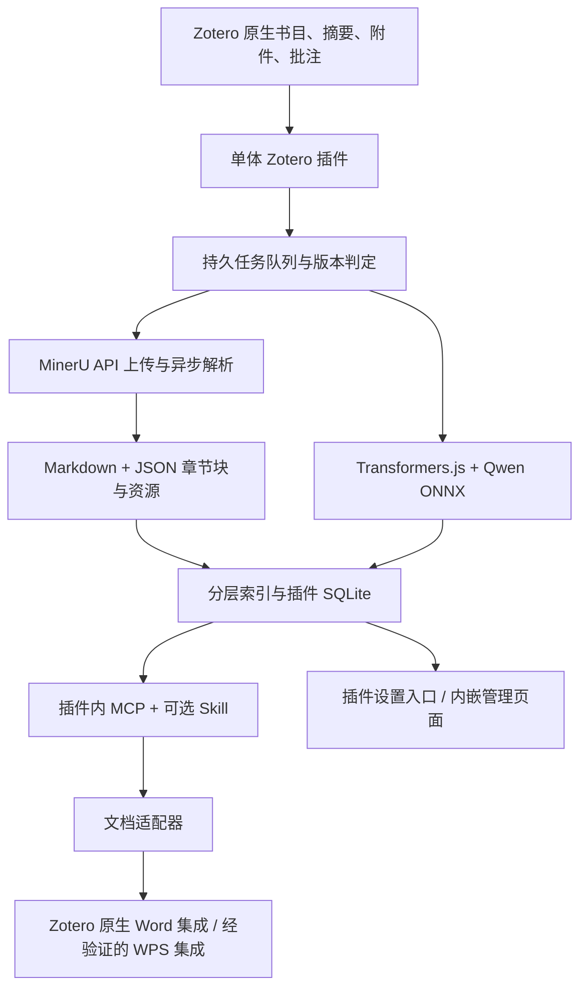

# Zotero 分层文献知识库：调研与实施方案

调研及更新日期：2026-10-30。状态：已按本方案实施 0.1.0 测试版，并在隔离 Zotero 10.0.7 配置中测试。本文保留设计目标；实际交付、验证结果与尚未实现的部分以 [README](../README.md) 为准。真实 Key 未写入源码或安装包，正式 Zotero 文献库未改动。

## 1. 结论

目前没有核实到一个同时完整满足“结构化 Markdown、Qwen 本地向量化、逐层阅读、自动去重入库、管理 GUI、Word/WPS 可刷新引用”的单一成熟插件。现有项目只用于借鉴生命周期、分层检索、增量索引和 MCP 设计，不作为本项目底座，也不复制其整套代码。

本项目采用**单个 Zotero 插件 + MinerU 云端解析 API**：不要求 Ollama、Python、Docling Serve、Docker、Qdrant、Chroma 或独立 MCP 服务。插件将 PDF 提交给 MinerU，取回 Markdown 和结构化结果；向量化使用插件内 JavaScript/ONNX，索引保存在本地 SQLite。模型首次使用时从模型仓库下载到插件数据目录，也支持本地导入。MinerU 是网络依赖，但无需用户部署额外服务；新 PDF 的完整解析需要联网，已有结果的查询、阅读和向量化可在模型就绪后离线运行。

MinerU Key 可在 Zotero 插件设置页和内嵌 GUI 的设置区配置，两个入口共享同一份凭据和状态。按用户指定的 90 天有效期提供提醒，并以 API 返回的过期错误为权威判定。真实 Key 不出现在方案、源码、示例、日志或导出配置中；本次提供的 Key 不落盘，实施后通过配置入口保存，不作为插件内置默认值。

用户已确认：文稿目标是 Word/WPS，要求 Zotero 可更新引用。发布方式尚未确认，暂不作闭源或商业分发假设。

## 2. 已核实的项目

星标数只是调研时的规模参考，不能代替兼容性与质量测试。README、源码、发布记录的核对结果如下。

| 项目 | 调研快照 | 可以复用 | 仍缺少或需核实 |
|---|---|---|---|
| [ZotSeek](https://github.com/introfini/ZotSeek) | 约 237 stars；v1.22.6；manifest 支持 Zotero 8–10 | 学习自动索引、右键索引、混合检索、章节/页码信息、SQLite、恢复、MCP 的理念 | 不作为底座；本项目重新实现更小的单体插件；授权文件需补核 |
| [54yyyu/zotero-mcp](https://github.com/54yyyu/zotero-mcp) | 约 5,647 stars；v0.15.1 | 学习 MCP 工具分组、Skill 的逐层调用方式、全文/页范围读取和引用链接 | 不引入其服务进程；服务/CLI 为 MIT，plugin 子目录为 AGPL |
| [cookjohn/zotero-mcp](https://github.com/cookjohn/zotero-mcp) | 约 1,253 stars；v1.6.0；仓库声明 MIT | 插件内 MCP、元数据/摘要/全文工具、右键操作、Ollama、状态列 | 层次主要为返回内容详略；并非完整的文献—章节—证据模型；源码向量实现与 README 有差异 |
| [zotero-docling](https://github.com/max3925vats/zotero-docling) | v0.5.0；AGPL-3.0；当前版本面向 Zotero 8–10 | 学习 PDF 转 Markdown 的入口、状态和重建交互 | 不引入 Docling Serve；解析使用 MinerU API |
| [Docling](https://github.com/docling-project/docling) | 约 69,848 stars；代码 MIT | 本地 PDF 版面解析、表格、OCR、Markdown、结构化 JSON | 模型授权另看模型卡；实际学科文献效果与速度需测 |
| [Zoteus](https://github.com/oscardvs/zoteus) | v1.23.0；MIT | CSL 和 Word 域结构的参考实现 | 作者明确说明尚未验证其生成文档能否被 Word Zotero 插件正确刷新，不能直接视为可靠生产路径 |
| [MinerU API](https://mineru.net/apiManage/docs) | 官方精准解析 v4 API；本次核对公开文档 | PDF 上传、异步解析、Markdown/JSON/图片结果、OCR/表格/公式能力 | 需配置有效 Key；处理有效期、配额、网络、任务恢复和结果缓存 |

### 2.1 ZotSeek 的实际复用边界（只学理念）

公开 API 有 `search`、`findSimilar`、`indexItems`、`getStats` 等。这里借鉴的是“Notifier + 持久队列 + 内容指纹 + 分层结果 + 页码链接”的设计，而不是调用其 API 或共享其数据库。`indexItems` 没有直接导入外部章节/块树的能力，正好说明本项目需要自己的结构层。

ZotSeek 同时具有插件内 ONNX 推理和本地服务两条路径。本项目只学习前者：计划使用 Transformers.js 的 `feature-extraction` pipeline，在插件托管的 Web Worker 中加载 Qwen3-Embedding-0.6B 的 ONNX 变体。Worker 可由插件本地 HTML 页面承载，具体与 Zotero/Gecko 的兼容性先验证，不假设任意 ChromeWorker 都能直接运行。按模型卡使用 `last_token` pooling 和归一化，查询输入加任务指令，文档输入不加查询指令。

`auto-index-manager.ts` 已处理新增条目、等待 PDF 和笔记变更，但新增附件分支主要检查“父条目是否仍在等待 PDF”。不能据此保证“几天后给已入库条目补 PDF”或“替换已存在 PDF”都能触发正确更新。必须补齐并测试这些场景。

### 2.2 不能只照 README 选技术

`cookjohn/zotero-mcp` README 写到 sqlite-vec，但当前 `vectorStore.ts` 实际说明并实现 SQLite 存向量、内存计算相似度，还包含 Int8/Float32 存储路径。不能将其当作现成 ANN 向量数据库使用，也不能直接承诺大规模性能。

ZotSeek 当前将自己的 SQLite 附加到 Zotero 数据库连接，代码专门处理 Zotero 回收连接导致 ATTACH 丢失的问题。本项目从中学习数据库连接生命周期的处理；优先验证用 Zotero 自带数据库封装打开独立派生库，不附加到主库，也不修改主库表结构。

## 3. Zotero 原生能力的复用

Zotero 是书目信息的唯一权威来源：标题、作者、期刊名、年卷期页、DOI、标签、分类、关联条目、批注和笔记从 Zotero API 获取。摘要直接读取 `abstractNote`。

这里需要澄清：Zotero 通常通过网页 translator、DOI/标识符和 PDF 元数据检索得到书目及摘要；并非所有 PDF 都能自动得到可靠摘要、章节或 Markdown。没有摘要时应返回 `missing`，不能把生成式摘要伪装成原文摘要。可选从解析结果提取明确标注的 Abstract，并记录来源，不默认覆盖 Zotero 字段。

Markdown 正式提取路径改为 MinerU 精准解析 API，复用其 OCR、表格/公式与版面解析结果。插件从结构化 JSON 生成章节、页、段、表图树，并与 Markdown 建立关联；不从扁平 Markdown 猜测全部页码。不同解析模型的 JSON schema 通过版本化适配器处理，页号从服务的 page index 转换并验证，未知位置保持为空。

Zotero 的原生全文继续用于快速搜索、预览和解析不可用时的降级阅读；这不算完成 MinerU 提取，也不静默切换到另一项云服务。没有 Key、Key 过期或网络中断时，已有结果及书目/摘要查询仍可用，新解析任务保留等待状态。密码、空文件、超限、乱码或部分结果分别显示实际原因，失败重建不覆盖旧结果。无需在插件内另捆绑 OCR 或通用 PDF 解析器。

“期刊信息层”包括 Zotero 已有的 publicationTitle、ISSN、卷期页等。影响因子、JCR/CAS 分区不属于 Zotero 默认保证的数据；第一版不依赖这些外部数据。

## 4. 推荐技术路线：单体插件

先建立精简的独立 TypeScript Zotero 插件工程，吸收现有项目的设计理念，不依赖它们或它们的数据库。可选开发脚手架只在构建时使用，先核验许可。插件 XPI 是唯一安装物；ONNX runtime/WASM 随包提供，模型是首次使用时下载的数据文件，不是常驻服务。普通使用者不安装 Node.js/npm；这些只是开发构建工具。



组件职责：

- Zotero 插件：事件、书目 API、队列、UI、检索编排、派生 SQLite、模型 Worker 和 MCP 的唯一宿主。
- MinerU 客户端：插件直接通过 HTTPS 上传 PDF、轮询解析状态、下载 Markdown/JSON/资源，管理鉴权与失败恢复；不需要 Python SDK 或本地 MinerU 部署。
- Zotero 全文能力：复用原生缓存搜索和预览，在 MinerU 不可用时明确提供降级阅读。
- Transformers.js/ONNX：插件内生成向量。模型首次下载后离线运行，不要求 Ollama 或任何 HTTP 推理服务。
- 插件内 MCP：回环地址上的 Streamable HTTP 端点直接调用插件 API；Skill 只是可选的短说明文件，不是后台进程。
- Word/WPS：单独的文档适配层；索引插件无法单靠格式化文本实现可更新引用。

单体方案的边界是：Zotero 主进程负责生命周期和轻量编排，全文切分、向量计算和相似度扫描放到 Worker；上传、轮询和下载使用异步网络操作。第一版不追求百万级文献；在中小型个人库中以 SQLite + 批量内存余弦扫描换取无需额外本地服务。规模超过实测上限后再考虑 WASM 向量索引，但不在 MVP 引入数据库服务。

### 4.1 MinerU 本地 PDF 接入流程

使用需要 Token 的精准解析 API，不以免 Token 的轻量接口替代。Zotero 文件位于本地，不能把本机路径作为可访问 URL 交给云端：

1. 复用本地 PDF hash 和解析配置指纹；结果仍有效则跳过上传。配置中首次启用 MinerU 自动解析时明确显示 PDF 将发送至 MinerU，之后按已启用范围自动处理，无需逐篇确认。
2. 通过 `POST https://mineru.net/api/v4/file-urls/batch` 申请签名上传链接，API 请求使用 `Authorization: Bearer <token>`。只填写任务必需的文件信息和不含个人书目数据的 `data_id`。
3. 按官方协议向签名地址 PUT 原始文件，不把 MinerU Bearer Key 转发到对象存储、CDN 或重定向目标。官方当前说明上传链接有效 24 小时，上传 URL 过期必须与 Key 过期区分。
4. 持久保存 batch/task 标识、文件映射、源指纹和阶段，再轮询 `GET /api/v4/extract-results/batch/{batch_id}`；不要求公网回调，不创建外部后台进程。进度对应 waiting-file、pending、running、converting、done、failed。
5. 完成后下载 `full_zip_url`，读取 `full.md`、内容列表、layout 等 JSON 和图片资源。使用 Zotero/Gecko 现成 ZIP 能力，校验解压路径、总量和文件数，不引入 ZIP 系统工具。
6. 校验源指纹及结果完整性后进入本地分层索引和向量化；重启先查询既有任务，避免重复上传。提交结果不确定时先对账，不假设 `data_id` 是服务端幂等键。取消本地任务不等于成功取消云端任务。

模型默认选择精准 API 文档推荐的 `vlm`，OCR/表格/公式参数按服务能力设置并写入解析指纹，设置调整只重建受影响阶段。当前公开文档说明精准 API 上限为 200 MB、600 页、每批不超过 200 文件；实现时集中管理可变限制，超限显示明确原因，不无提示截断或偷偷拆分。

### 4.2 Key 配置与保存

两个设置入口提供相同字段与操作：Key 密码输入框、保存/替换/清除、测试连接、生成日期或到期日期（可选）、预计/实际到期时间、上次验证时间、当前状态、打开 MinerU Token 管理页。保存不等于已验证，界面也不把“已配置”显示为“有效”。

Key 使用 Zotero/Gecko 提供的登录凭据管理能力保存在独立插件命名空间，实施时先验证目标 Zotero 版本支持；不能悄悄降级到明文 preferences、SQLite、localStorage、配置 JSON 或模型目录。普通设置只保存非敏感时间和状态；调用方读取不到 Key。

GUI 和设置页通过同一个插件配置模块写入并实时同步。已保存凭据默认只显示“已配置”，不将完整 Key 回填给页面；用户可直接替换或清除。插件特权层负责发起 MinerU 请求，MCP、Skill、管理页普通数据接口、诊断和备份都不返回 Key、Authorization 或带签名的 URL。配置导出不携带凭据。

“测试连接”优先采用经官方确认的无解析鉴权接口；当前已核对文档未确认专用 Key 检查端点，因此不能虚构 `/validate`。若没有该接口，验证过程只使用经确认能进行鉴权且不会新建/上传/解析文献的只读请求；如不能可靠判断则显示“已配置，尚未验证”，由下一次实际任务确认。不得为了测试自动创建消耗配额的解析任务。

### 4.3 90 天有效期与过期识别

90 天作为用户给定的有效期规则。倒计时必须从 Key 的真实签发时间计算，不能从“在插件中粘贴/保存的日期”重新计 90 天。若服务返回权威到期时间则使用该时间；否则允许用户输入生成日期或到期日期，标注“预计”。只知道生成日期时按 90 天估计；未知时显示“有效期未知，实际调用时校验”，不猜测当前 Key 的到期日，也不假设 Key 是可解码的 JWT。

设置/GUI 在预计剩余 7 天、3 天和 1 天提示，重启后状态保留，同一阈值不反复弹窗。预计时间已过但服务未验证时显示“预计已到期，需验证”；明确的服务端结果优先，不仅凭客户端时钟封禁任务。每次真实 API 响应更新上次验证状态；断网不能把已验证有效改成已过期。

官方错误码表明确区分：

| 响应/情况 | 插件结构化状态 | 界面与 Agent 反馈 | 重试策略 |
|---|---|---|---|
| 业务码 `A0211` | `MINERU_TOKEN_EXPIRED` | MinerU Key 已过期，请在插件设置或 GUI 更新 Key | 暂停需要鉴权的 MinerU 阶段，等待更新 |
| 业务码 `A0202` | `MINERU_TOKEN_INVALID` | Key 无效或格式错误，请检查并重新配置 | 等待配置修正，不能冒称过期 |
| HTTP 401/403，无明确业务原因 | `MINERU_AUTH_FAILED` | 鉴权失败，可能涉及 Key 或访问权限；附脱敏原因 | 暂停相关阶段，不统称过期 |
| 签名上传/下载地址过期 | `MINERU_SIGNED_URL_EXPIRED` | 文件链接已过期，需要重新获取 | 刷新链接/任务信息；不清空 Key |
| HTTP 429 或明确配额错误 | `MINERU_RATE_LIMITED` / `MINERU_QUOTA_EXCEEDED` | 限流或额度不足及下次可重试时间（若有） | 退避或等待额度，不当作 Key 过期 |
| 超时、断网、5xx | `MINERU_NETWORK_ERROR` / `MINERU_SERVICE_ERROR` | 网络/服务不可用 | 有上限退避，不修改 Key 的有效性结论 |

同时检查 HTTP 状态和 JSON `code`，不能只判断 HTTP 200；`code` 兼容数字成功码和字符串错误码，未知值保留为脱敏服务错误。过期在上传链接申请、轮询等任何阶段发生时，都需传播到队列、状态列、GUI 和 MCP。服务端脱敏 `msg`、`trace_id`、发生阶段和时间用于排查，不输出原始请求头或响应中的敏感链接。

收到过期结果后进入全局鉴权阻塞状态，合并同类提醒并停止无意义重试；正在运行的请求可完成，已经下载的结果继续本地向量化，已有索引正常查询。新入库任务保留为 `blocked_credentials`，不能永久失败或丢弃。已知签名且无需鉴权的下载可在有效期内继续，不为绕过过期而生成新云端请求。

用户替换 Key 后递增 credential revision，旧 Key 在途请求的延迟错误不能覆盖新 Key 状态；更新 Key 不删除已成功解析结果或向量。验证成功后先核对既有任务的可访问性，再恢复等待任务；新 Key 若属于不同账号或无权访问旧任务，返回权限原因并提供重建入口，不静默重复提交。

MCP/GUI 错误示例（Key 永不进入响应）：

```json
{
  "ok": false,
  "error": {
    "code": "MINERU_TOKEN_EXPIRED",
    "provider": "mineru",
    "provider_code": "A0211",
    "message": "MinerU API Key 已过期，请在 Zotero 插件设置或知识库 GUI 中更新。",
    "retryable": false,
    "requires_user_action": true,
    "action": "update_mineru_key"
  },
  "job": { "state": "blocked_credentials", "resume_after_credentials_update": true }
}
```

MCP 工具调用发生此类业务错误时返回工具错误标记和相同结构化原因；`literature_status` 正常返回组件状态。`retryable:false` 表示当前凭据下不自动重试，更新凭据后仍可恢复原 job。若只知道服务确认过期而不知道具体到期时间，明确显示未知，不捏造时间戳。

## 5. 分层读取：结构优先、混合搜索辅助

| 层级 | 保存内容与来源 | Agent 常用操作 | 向量化策略 |
|---|---|---|---|
| L0 书目/期刊 | Zotero 原生字段、分类、标签 | 按作者、期刊、年份、DOI 筛选，列出候选 | 结构化过滤优先，通常无需嵌入 |
| L1 摘要 | 原生摘要、标题、关键词，保留来源 | 批量读候选摘要、判断主题相关性 | 每篇独立摘要向量 |
| L2 全文结构 | 文档目录、章节标题、起止页、表图目录 | 看目录，指定 Methods/Results 等章节 | 目录通常直接读取，可选章节代表向量 |
| L3 证据正文 | 章节、段落、表格/图注、页码、块 ID | 读某节、某页、上下文或全文 | 按结构切块后向量化 |
| L4 个人材料 | Zotero 笔记、高亮、批注 | 查询个人观点或摘录 | 可选独立索引，明确不是作者原文 |

默认发现文献可以先做 L0 过滤和 L1 混合检索，但摘要不能成为全文候选的硬门槛。缺失摘要、摘要未提及的方法/数据集、以及直接问正文证据时，允许独立全文召回。结果按文献聚合并限制每篇命中数，避免长文章占满候选。

Agent 推荐流程：检索候选书目 → 批量读取摘要 → 查看目录 → 定位章节 → 读取段落及邻近上下文 → 输出带来源的论断 → 选择文献插入引用。读取接口允许按文献/章节直接访问，不要求每次重新向量检索。

全文检索先混合关键词与向量，再用 RRF 融合；DOI、作者、专有词和中文标题不能只依赖向量。沿用 Zotero 关键词能力，并评估中文分词，不能默认 SQLite FTS5 的英文分词器适合中文。参考文献章节保留可读，默认不参与正文语义召回。

chunk 建议从约 400–800 tokens 起步，按标题、段落和表格边界切分，有限重叠，最终以样本评估调整。以检索小块命中、读取完整父段/章节的方式保留上下文。长文 32K 支持不意味着整篇只生成一个向量。

## 6. 可借鉴的先进知识库模式

- [PageIndex](https://github.com/VectifyAI/PageIndex)：借鉴目录树导航和按页读证据。其推理式索引/检索涉及额外 LLM；Qwen Embedding 0.6B 不能承担该生成任务。本项目第一版使用确定性章节树，不引入这项必需依赖。
- [LlamaIndex](https://github.com/run-llama/llama_index)：借鉴父子节点、结构化过滤和小块召回后读取父节点的模式。当前业务边界清楚，第一版无需把整个框架引入插件。
- [GraphRAG](https://github.com/microsoft/graphrag)：适合后续跨文献实体、主题与关系分析；其实体抽取和摘要构建有额外 LLM 成本，不作为全文查询的前置步骤。
- MinerU：直接使用其精准 API 提取 Markdown 和结构化 JSON，以版面块形成章节树与证据索引。Docling 仅作调研参考，不引入其转换服务。

## 7. 模型与存储

官方 [Qwen3-Embedding-0.6B 模型卡](https://huggingface.co/Qwen/Qwen3-Embedding-0.6B) 给出 32K 上下文、最高 1024 维和可裁剪维度。插件内 Qwen 使用 1024 维归一化向量和 last-token pooling；32K 是模型能力，不是插件每批默认推理长度。实际以数百 tokens 的结构化小块和小批次控制内存。

[Qwen ONNX 社区模型](https://huggingface.co/onnx-community/Qwen3-Embedding-0.6B-ONNX) 提供 Transformers.js 示例和量化权重；当前 q8 的单个 ONNX 文件约 614 MB（十进制），还有 tokenizer、runtime 和运行内存，不能与 Ollama GGUF 的体积混为一谈。这里使用的不是 Qwen 官方直接发布的 ONNX，需固定 revision、校验文件与许可，并与官方示例比较向量相似度。该模型存在不等于已验证 Zotero/Gecko 能运行它，这是首个技术验证项。

若 Qwen 的 WASM 速度或内存不合格，在同一插件内切换更轻的多语言 E5-small ONNX（384 维、512 token 上限），不要求用户部署服务。E5 使用自己的 query/passage 前缀与 mean pooling，不复用 Qwen 配置。最终默认模型按插件内实测确定；保留用户优先选择 Qwen 0.6B 的目标，不将“小模型回退”隐藏起来。WebAssembly CPU 为兼容基线，WebGPU 只是经目标 Zotero 版本验证后的可选加速；有独显不等于一定可启用。

第一版使用插件自己的 SQLite 文件，保存元数据快照、章节、块、向量和任务；不需要 SQLite 命令行或安装扩展。关键词检索优先复用 Zotero，派生块上的分词/评分在后台执行；可用时再利用自带 SQLite 的全文能力。相似度计算分批放到 Worker，不把全部向量转换成巨大的 JS number 数组。先以 Float32 存储作为正确性基线，必要时评估量化和 WASM 检索优化；不引入外部数据库。

每个向量带 embedding 空间指纹：模型与 revision/digest、量化、维度、query 指令、归一化策略。即使维度相同，不同空间也不能比较。模型变更只重算向量；解析器变更重算结构及受影响向量；分类/期刊字段变更通常只更新书目索引。

PDF 派生物保留 MinerU 原始 Markdown、JSON 和图片等资源，以及规范化 `document.md`、`document.json` 和解析 manifest。记录 provider、模型/配置、源 hash 和 schema 版本；JSON 保存章节/页/段位置，保留原结果便于修复适配器。需要核对复杂表图时回到原 PDF。缓存放本地派生目录，默认不成为 Zotero 同步附件，可按需导出；签名链接不作为长期缓存身份。

## 8. 自动入库、重复跳过和一致性

逻辑身份至少包括 Zotero 实例/库标识 + itemKey + attachmentKey。仅 itemKey、文件名或 DOI 都不足以作为唯一键；群组库与个人库可能冲突，预印本和正式版本也不应直接合并。

管线：收到事件 → 持久入队并合并重复事件 → 等待附件稳定 → 拍摄源版本 → 复用或解析 → 分块/嵌入 → 验证源版本未变 → 原子发布新 generation。Notifier 回调只排队，不做耗时推理。处理期间源改变则丢弃旧任务提交并重排，防止覆盖新版。

必须覆盖：新增父条目+PDF、给旧条目补 PDF、独立 PDF 后续生成父条目、多 PDF、链接附件与路径变更、同步文件延迟、原位替换文件、批量导入、合并/删除/恢复、模型不可用、重启中断。启动和定期轻量对账用于弥补事件遗漏，不依赖文件监听覆盖全部同步情形。

建议状态分开表示：书目就绪、摘要缺失/就绪、PDF 等待、排队、上传中、MinerU 排队/解析/转换中、结果下载、嵌入中、完整、降级、内容过期、凭据阻塞、失败。索引内容过期与 MinerU Key 过期使用不同字段和提示；无摘要或无 PDF 的书目仍可查询，不把它们标成完整全文索引。

右键菜单：加入知识库、强制重建、查看状态、从派生索引移除。正常重复入库返回 `skipped/current`，进行中的任务返回已有 jobId；内容改变则只更新失效阶段。完成的唯一性由数据库约束和任务锁保证。

去重按完整指纹判断，而非“有一行记录就跳过”。内容缓存可按 PDF SHA-256 复用，但不同 Zotero 条目的书目信息与库权限保持独立。metadata hash、PDF hash、parser/chunker 版本、embedding fingerprint 分开保存。新版本全部可用后切换 active generation，失败时保留旧版并标为过期。删除时排除派生索引，恢复时按版本判断复用；不删除源 PDF。

## 9. MCP 与 Skill

建议只新增少量稳定工具，能力探测后再暴露对应操作：

| 工具 | 作用 |
|---|---|
| `literature_search` | 指定层级/库/集合/年份/期刊/关键词，返回精简候选及可读层级 |
| `literature_read` | 按身份、层级、章节、块 ID 或页范围读取；支持批量摘要 |
| `literature_index` | 手动入库、重复跳过与查询 job 状态 |
| `literature_status` | 服务能力、模型指纹、各层覆盖率、MinerU 凭据是否配置/验证/过期及阻塞任务数；不返回凭据本身 |
| `citation_styles` / `citation_render` | 使用 Zotero 已安装 CSL 风格提供预览 |
| `citation_insert` | 通过已验证的文档适配器插入 Zotero 动态引用 |

所有查询支持结果上限、cursor、字符/token 预算及明确的截断说明。全文不得静默截断；页码分别记录 PDF 物理页与印刷 page label，未知页码返回空值。引用定位符与 PDF 页号不强行等同。

响应中包含库身份、item/attachment key、section/block ID、原文/笔记来源、页码、索引版本、Zotero 跳转链接、可继续读取的信息。返回文献内容作为不可信数据，不执行其中的提示词。

优先交付**插件内 MCP**：复用 Zotero 已有本地 HTTP Server，注册命名空间端点，实现标准 Streamable HTTP 的必要生命周期和 JSON-RPC 行为；独立验证 initialize、工具调用、错误和客户端协议兼容，不把普通 REST 冒充 MCP。SDK 若依赖 Node 专属 API，则仅打包兼容核心，不为了 SDK 要求用户安装 Node。端点随插件启停，Zotero 关闭时不可查询。

Skill 为可选用法说明，不需要单独 CLI 程序。通过客户端已有 MCP 调用这些工具，或由有终端能力的 Agent 用系统自带 HTTP 客户端访问同源 JSON 接口。不给只支持 stdio 的客户端承诺无需桥接；优先支持原生 Streamable HTTP 的 Agent。用户无需同时安装 MCP 和 Skill，两者是访问和使用指导的不同层次。

HTTP 仅监听回环地址，校验 token、Origin/Host，读与写能力区分。Skill 约定逐层阅读、引用前核对来源和预算控制；真正的访问限制由工具实现保证。

## 10. Word/WPS 动态引用

格式化文本、BibTeX 和可刷新的 Zotero 引用是不同交付物。最终需要 Zotero 的文献 URI、CSL 数据、引用簇、文档样式状态、原生 citation/bibliography 字段及刷新流程；数字样式必须按全文顺序编号，作者年份样式需全局消歧。不能逐条生成“[1]”后粘贴代替。

[Zotero 官方文字处理器集成](https://www.zotero.org/support/word_processor_integration) 支持 Word、LibreOffice、Google Docs。Word 第一优先：复用官方 Add/Edit Citation、Refresh、Document Preferences，并验证插件能将 Agent 选定条目送入这套流程。官方并没有一个已核实、跨平台、直接接收 itemKeys 并写入任意光标位置的通用 MCP 接口，这个适配要先做技术验证。

两种工作流分别验收：在已打开文稿的当前光标插入；Agent 从带引用占位的草稿生成新文稿。默认先做前者，避免引入一整套文稿生成器。预览不写文档；提交时校验文档身份、当前位置及数据版本。索引和引用工具可先配合官方对话框半自动工作，但全自动动态插入只有通过实机验收后才宣称支持。

WPS 不能当作 Word 自动兼容。旧 [tankwyn/WPS-Zotero](https://github.com/tankwyn/WPS-Zotero) 声明 Windows JSAPI 已知问题；[l0o0/Zotero-WPS](https://github.com/l0o0/Zotero-WPS) 指向较新的 [wangrui5015/Zotero-WPSJS](https://gitee.com/wangrui5015/Zotero-WPSJS)，其 README 同时存在授权、安装要求与平台问题。这里只核实文档，尚未安装或验证。优先兼容用户已有集成，不把任一 WPS 加载项无条件捆绑为必需依赖。

Word/WPS 的验收应包括：单篇与多篇引用、印刷页码、同作者同年、顺序调整、插入/删除后重新编号、GB/T 7714/APA/IEEE 切换、条目字段修改后刷新、保存关闭再打开、Word/WPS 往返。脚注型风格另测。动态引用不能用普通文本的视觉相似通过验收。

## 11. 内嵌 GUI

使用 `Zotero.PreferencePanes.register` 注册插件设置，提供“打开知识库管理器”。管理器用插件打包的页面打开为 Zotero 标签页或独立窗口，避免远端页面获得特权。支持从插件管理页的设置/首选项入口进入，确切按钮行为按 Zotero 版本验证，不修改 about:addons 内部 DOM。另提供工具菜单作为稳定入口。

管理页包含：文献表格和过滤、书目/摘要/全文覆盖率、队列进度、失败重试、模型状态、索引空间、单篇目录树、Markdown 预览、证据页跳转、入库/重建/移除，以及与插件设置同步的 MinerU Key 配置区。过期时显示可操作提示“MinerU Key 已过期，N 个任务等待更新”，进入配置区后更新、验证、恢复。提供按年份/期刊/集合的覆盖率图；二维向量投影是后续可选视图。

Markdown 禁止任意脚本/HTML 执行，资源访问限制在该文档派生目录。模型安装、下载体积、进度和离线缺失状态应可见。PDF 提取会上传到 MinerU；本地向量化、存储及已有结果检索在本机。调用远程 Agent 时选中的片段仍会进入该 Agent 的服务。界面明确这些数据路径，不宣称所有处理离线或文献永不外发。

## 12. 实施顺序与验收门槛

1. **单插件技术验证。** 在独立 Zotero 配置中验证 Transformers.js/ONNX/WASM、Qwen q8 与 E5-small、独立 SQLite、插件内 MCP；验证 MinerU 本地文件上传、异步任务与结果导入，以及两个入口的凭据保存。尽早验证 Word 原生动态引用路径。没有额外本地服务和 Node/Python 运行依赖才算通过。
2. **独立插件与增量管线。** 实现 MinerU Markdown/JSON 转块树、摘要层、版本指纹、持久任务和失效更新。验收自动入库、重复跳过、旧条目补 PDF、源替换、多附件、群组库、中断恢复和扫描件解析。过期不阻断本地查询和已经完成提取的向量化。
3. **MCP/Skill 与管理页。** 完成分层搜索/直接读取、预算/分页、证据链接和 GUI。Agent 能按书目—摘要—目录—章节读取；无摘要仍能全文发现；可查失败与过期原因。
4. **引用适配与分发。** 完成 Word 全自动引用路径、刷新/样式回归；再按实际 WPS 版本完成适配。打包单个 XPI、模型下载/本地导入、版本迁移、升级回滚和许可证清单。现有 Zotero Word 集成继续负责可刷新引用；WPS 如需 Office 侧加载项，应明确它属于文档兼容条件，不能声称 Zotero 插件独自控制任意 WPS 文稿。

第一阶段只验证单体方案最关键的兼容风险，不安装 ZotSeek 或外部模型服务；通过后再展开开发。不提前承诺具体工期和检索速度。

MinerU 配置与异常验收必须覆盖：两个入口共享状态、清除/替换 Key、未知签发日期、导入一个已使用较久的 Key（不能重算 90 天）、7/3/1 天提醒、HTTP 200 + `A0211`、`A0202`、无业务码 401/403、签名 URL 过期、429/额度不足、断网/5xx、轮询中 Key 过期、旧请求迟到、重启保留阻塞任务、更新 Key 后恢复且不重复入库、不同账号任务无权访问。用 mock/fixture 注入过期响应，不等待 90 天也不消耗真实 PDF 配额；对代码/日志/导出执行凭据泄漏检查。

检索样本覆盖：DOI/作者精确查询、中文问题搜英文论文、摘要不出现的正文事实、指定方法/表格、无摘要/扫描 PDF、笔记与原文区分。记录 Recall@10、证据页正确率、结果来源准确性、索引时间、冷/热检索 p50/p95、运行内存和故障恢复。速度指标在确定文献规模和样本后设定。

## 13. 主要证据与版本锚点

- ZotSeek：main `6dbaf734e4acf61876bf358b20e622289edf3eeb`。核对 [API](https://github.com/introfini/ZotSeek/blob/main/docs/API.md)、[MCP](https://github.com/introfini/ZotSeek/blob/main/docs/MCP.md)、[自动索引](https://github.com/introfini/ZotSeek/blob/main/src/core/auto-index-manager.ts)、[模型注册](https://github.com/introfini/ZotSeek/blob/main/src/core/model-registry.ts)、[SQLite](https://github.com/introfini/ZotSeek/blob/main/src/core/vector-store-sqlite.ts)、[package.json](https://github.com/introfini/ZotSeek/blob/main/package.json)。
- 54yyyu/zotero-mcp：main `eb016b1b746d183d19ba746249262cd0395f926c`。[语义检索配置](https://github.com/54yyyu/zotero-mcp/blob/main/docs/semantic-search.md)、[许可证说明](https://github.com/54yyyu/zotero-mcp#license)。
- cookjohn/zotero-mcp：main `81d0777b49ded0959d197c7610d8b6e5f32c2485`。[实际向量实现](https://github.com/cookjohn/zotero-mcp/blob/main/zotero-mcp-plugin/src/modules/semantic/vectorStore.ts)。
- Docling：[主仓库](https://github.com/docling-project/docling)、[现成服务](https://github.com/docling-project/docling-serve)、[Zotero 集成示例](https://github.com/max3925vats/zotero-docling)。
- MinerU：[官方 API 入口](https://mineru.net/apiManage/docs)、[官方 API 文档](https://mineru.net/doc/docs/index.html)、[输出格式说明](https://opendatalab.github.io/MinerU/reference/output_files/)。2026-10-30 核对上传/轮询协议、ZIP 内容和 `A0202`/`A0211` 错误表；90 天期限按用户要求纳入，未获得当前 Key 的签发时间或到期时间。
- Zotero：[现代插件 API 与设置页](https://www.zotero.org/support/dev/zotero_7_for_developers)、[JS API](https://www.zotero.org/support/dev/client_coding/javascript_api)、[HTTP 文档集成源码](https://github.com/zotero/zotero/blob/main/chrome/content/zotero/xpcom/server/server_connectorIntegration.js)、[CSL 调用源码](https://github.com/zotero/zotero/blob/main/chrome/content/zotero/xpcom/cite.js)。
- Word 域代码的参考与作者自述限制：[Zoteus word-documents](https://github.com/oscardvs/zoteus/blob/main/docs/word-documents.md)。
- 插件内推理候选：[Qwen ONNX 模型与 JS 用例](https://huggingface.co/onnx-community/Qwen3-Embedding-0.6B-ONNX)、[多语言 E5-small ONNX](https://huggingface.co/Xenova/multilingual-e5-small)、[E5 原模型说明](https://huggingface.co/intfloat/multilingual-e5-small)。

这些是在线文档和部分源码静态调研，尚未运行项目、解析样本 PDF、下载 Qwen 权重或完成 Office 兼容测试。本次只访问公开 MinerU 文档，未使用用户 Key 发起鉴权、上传或解析请求，未验证该 Key 当前是否有效。项目宣传的速度和准确率没有作为本方案承诺。
